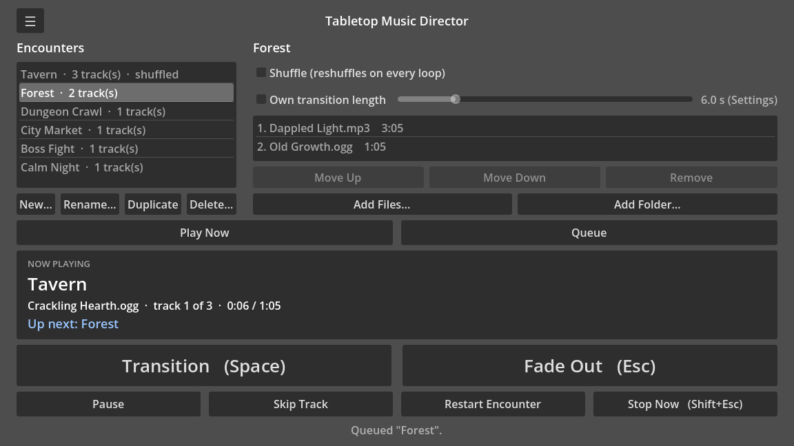
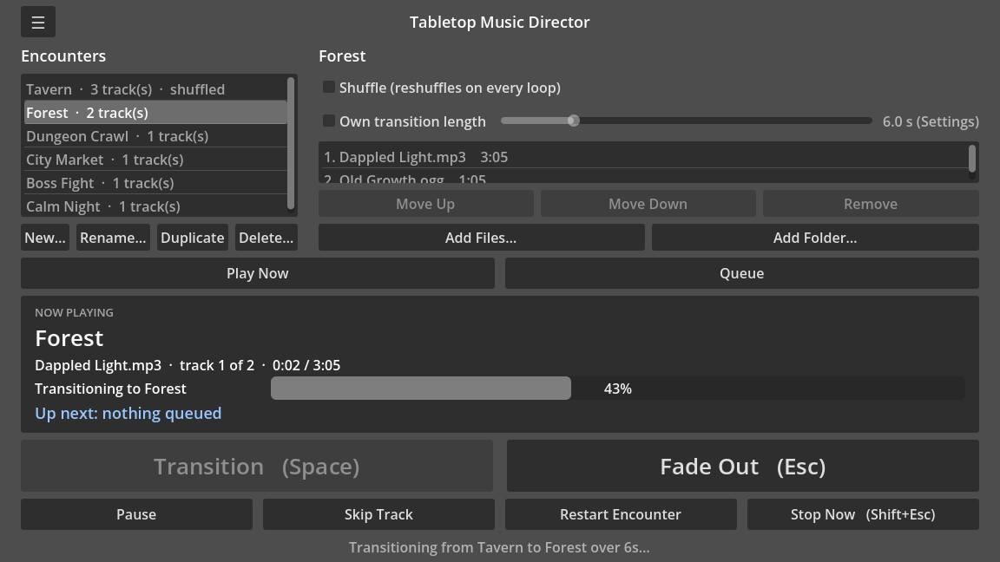
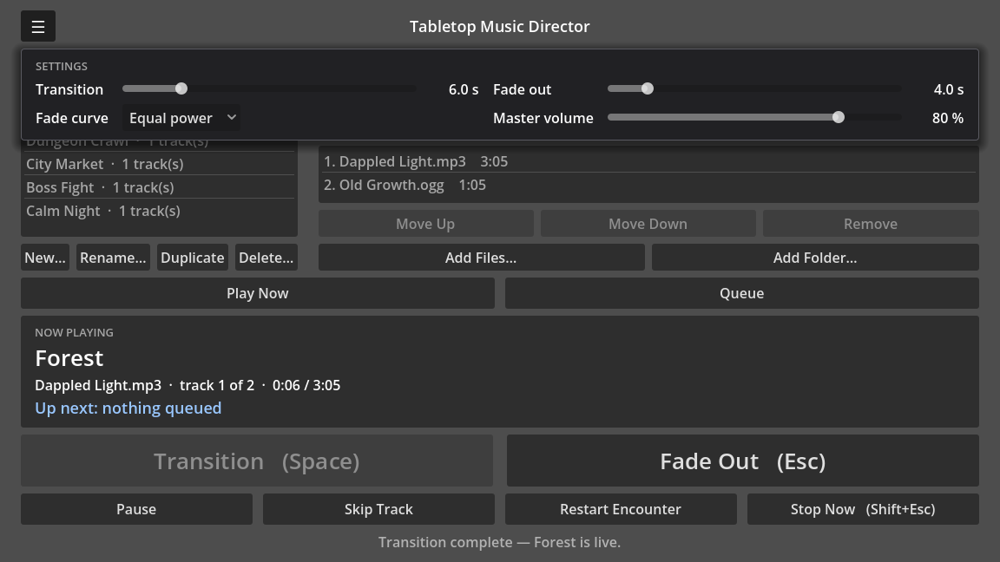

# Tabletop Music Director

A desktop application for running background music during tabletop RPG sessions. Organize your music library into **encounters** (Tavern, Forest, Boss Fight, etc.), queue up the next encounter, and crossfade between them with a single click—all while managing your table.

For **Windows** (x64) and **Linux** (x86_64).

This repository holds the downloads and the user guide; the source code is kept separately.

## Features

- **Encounter Library**: Create, rename, duplicate, delete and reorder encounters, each a named list of tracks
- **Looping Playback**: Tracks play in sequence and loop seamlessly until stopped
- **Smooth Transitions**: Crossfade between encounters, with adjustable transition and fade-out lengths and a choice of fade curve
- **A/B Decks**: Queue the next encounter while the current one plays
- **Per-encounter Transitions**: Let a Boss Fight slam in while a Forest drifts in slowly
- **Fade-out Stop**: Music fades out gracefully—no abrupt cuts
- **Pause, Skip and Restart**: Hold the music mid-track, jump to the next track, or start an encounter over
- **Keyboard Shortcuts**: Fast control mid-session (`Space` to transition, `Esc` to stop, `1–9` to queue)
- **Shuffle**: Optional per-encounter shuffle, reshuffled on every loop and never repeating the track that just played
- **Persistence**: Your encounter library and settings are saved after every change
- **Master Volume Control**: Balance music against voices at the table

## Download and Run

Downloads are on the
[Releases page](https://github.com/cclapham/TabletopMusicDirector/releases). Nothing
else needs installing — the .NET runtime is bundled.

**Windows (x64):** the simplest way is the installer,
`TabletopMusicDirector-<version>-windows-x64-setup.exe`.

- It asks whether to install for you only (the default, no admin rights needed)
  or for everyone on the PC (asks for admin).
- It adds a Start Menu entry, and a desktop shortcut if you tick it.
- To uninstall, use **Settings → Apps**. It asks whether to delete your
  encounter library and settings too; the default keeps them, so reinstalling
  brings them back. Your music files are never touched.

Prefer not to install? Download `TabletopMusicDirector-<version>-windows-x64.zip`
instead, unpack it anywhere, and run `TabletopMusicDirector.exe`. Keep the
`.exe` and the `data_RPGMusicPlayer_windows_x86_64` folder beside it together.

The app and installer are not code-signed, so Windows SmartScreen may say
*"Windows protected your PC"* the first time; choose **More info → Run anyway**.

**Linux (x86_64):** Download `TabletopMusicDirector.x86_64` from the
[Releases page](https://github.com/cclapham/TabletopMusicDirector/releases),
make it executable (`chmod +x TabletopMusicDirector.x86_64`), and run it.

## Supported Audio Formats

- **OGG Vorbis** (`.ogg`)
- **MP3** (`.mp3`)

The app plays each file from its place on disk, inside your
[music folder](#your-music-folder). A file added from anywhere else is copied
into that folder first, and only if you agree.

> **No WAV or FLAC.** Godot decodes both only through its editor import
> pipeline, which needs the file inside the project. `AudioStreamWav` has no
> runtime load-from-bytes API in Godot 4.7, so a WAV picked from an arbitrary
> folder cannot be played. Convert those files to OGG.

## Using the App

### Basic workflow

1. **Create an encounter**: press **New…** under Encounters and name it (e.g. "Tavern").
2. **Add tracks**: **Add Files…** or **Add Folder…** in the editor beside it.
   The first time, you are asked to choose your [music folder](#your-music-folder).
3. **Play**: select the encounter and press **Play Now**.
4. **Queue and transition**: select the next encounter, press **Queue** (or a
   number key `1–9`), then press `Space` to crossfade into it when the moment comes.
5. **Stop**: press `Esc` to fade out, or `Shift+Esc` for an immediate hard stop.

### Controls

**Encounters** (left)

- **New…**, **Rename…**, **Duplicate** and **Delete…** act on the selected
  encounter. Deleting asks first and never touches your audio files. Deleting
  the encounter that is playing does not stop it; deleting the queued one
  empties the queue.
- **Move Up** / **Move Down** reorder the selected encounter. The order is
  saved, and it decides which encounter each `1–9` key queues.

**Encounter editor** (right)

- **Add Files…** / **Add Folder…** add OGG and MP3 tracks, listed with each
  file's name (without the extension) and length. A folder adds every supported file directly inside it,
  in file-manager order, and reports any it skipped. Files from outside your
  [music folder](#your-music-folder) are copied into it first, if you agree.
- Select a track to **Move Up**, **Move Down** or **Remove** it.
- **Shuffle** plays the tracks in a random order, reshuffled on every loop.
- **Own transition length** — see [Settings](#settings).

**Playback**

| Control | Key | What it does |
|---------|-----|--------------|
| **Play Now** | | Start the selected encounter at once, with no fade |
| **Queue** | `1–9` | Load the selected encounter (or encounter 1–9) to transition to next, while the current one keeps playing |
| **Transition** | `Space` | Crossfade into the queued encounter; with nothing playing, fade it in from silence |
| **Fade Out** | `Esc` | Fade the music out and stop; press again during the fade to stop at once |
| **Pause** / **Resume** | | Hold the music where it is, with a short fade, and carry on from the same point |
| **Skip Track** | | Fade the current track out over a second, then play the next one |
| **Restart Encounter** | | Fade the current track out over a second, then go back to the playing encounter's first track (a shuffled one draws a fresh order) |
| **Stop Now** | `Shift+Esc` | Hard stop, no fade; kept apart from Fade Out so it is not hit by mistake |

Pausing mid-transition freezes the transition. While paused, Transition, Skip,
Restart and Play Now wait for Resume; Fade Out and Stop Now end playback at once.
Pause is unavailable during a fade-out.

Presses during Skip's or Restart's one-second fade add up rather than starting
over: Skip three times to move three tracks on, or Skip then Restart to land on
the first track. The new track starts at full volume. Transition, Fade Out, Stop
Now and Play Now during that second cancel it.

The **Now playing** panel shows the live encounter, the track (its name, its place
in the encounter, and time elapsed / length), and what is **Up next**. While a
transition or fade-out runs, a progress bar shows how far it has got.

Editing the encounter that is playing does not interrupt it: the track playing now
finishes, and the changes apply from the next track. Editing the queued encounter
updates what the next transition plays.

### Keyboard Shortcuts

| Key | Action |
|-----|--------|
| `Space` | Transition to queued encounter |
| `Esc` | Fade out and stop |
| `Shift+Esc` | Hard stop (immediate) |
| `Esc` (again, while fading out) | Stop at once |
| `1–9` | Queue encounter 1–9, counting down the encounter list |

`1–9` work from the number row on any keyboard layout (they go by key position, so
AZERTY works unshifted) and from the numeric keypad. A shortcut does exactly what
its button does, and nothing when its button is disabled. Shortcuts stand aside
while you are typing a name or a dialog is open, so Space types a space and Esc
closes the dialog. Space always means Transition — it does not press whichever
button you last clicked (Enter still does).

### Settings

Press the **☰** button at the top left to open the settings panel over the
encounter library, and again to close it. Changes take effect at once and are
saved with the library. The playback controls stay uncovered while it is open.

- **Transition**: how long the crossfade between encounters takes (default 5 s)
- **Fade out**: how long Fade Out takes to reach silence (default 4 s)
- **Fade curve**: the shape every fade follows — transitions, Fade Out and
  Pause (default Equal power)
- **Master volume**: how loud the music is, 0–100 % (default 100 %)
- **Music folder**: where you keep your music — see below. **Choose…** changes it.

The durations range from 0.5 s to 30 s in 0.5 s steps; drag a slider, or click
it and use the arrow keys. A fade already running keeps the length it started
with.

Master volume sits on top of your system volume: 100 % is the files' own level
at whatever the system is set to, and it never boosts above that, so nothing
clips. The slider follows how loud the music *sounds* — 50 % is about half as
loud (−10 dB) — and you hear each change as you drag. It turns the whole app
down without touching a transition or fade in progress.

**Equal power** holds the level steady through a crossfade, so the table should
not notice the change of mood. **Linear** ramps both volumes in straight lines,
which dips audibly — about 3 dB — in the middle of a crossfade, because two
different pieces of music add up in power, not amplitude. Linear is there for
comparison, or if you prefer how it sounds. A new curve applies from the next
fade.

**Per-encounter transition length.** In the encounter editor, tick **Own
transition length** to give transitions *into* that encounter their own length
— a Boss Fight that slams in, a Forest that drifts in — whatever was playing
before. It also applies when Transition fades the encounter in from silence.
Untick it to go back to the Settings value, which the slider then shows, greyed
out. Fade Out always uses the Settings value.

### Your music folder

The music folder is where you keep the music you play. Tracks inside it are saved
*relative* to it, so if you move your music to another drive or computer, the
library follows: change the folder in Settings, and every track is found again.

- **The first time you add tracks**, you are asked to choose it.
- **Adding a file from somewhere else** offers to copy it into the music folder,
  into a subfolder named after the encounter (`<music folder>/Tavern/`).
  Characters a folder name cannot hold become `_`. Decline, and the file is not
  added. Renaming an encounter later does not rename its folder.
- **If a file of that name is already there**, you choose: **Use Existing** (the
  track plays the file already there), **Keep Both** (the copy is numbered,
  `name (2).ogg`), or **Skip**. Nothing is ever overwritten.
- **Changing the music folder** asks whether your music *moved* there (tracks are
  looked for in the new folder, at the same place inside it) or whether it is a
  *different folder* (tracks keep pointing at the files they play now).
- **Whenever the folder is set or changed**, tracks still outside it are listed
  with an offer to copy them in. Ones you leave keep playing from where they are,
  but won't follow the folder if it moves.

### Where your library is saved

Encounters and settings are saved to `library.json` after every change, in the
app's data folder:

| Platform | Folder |
|----------|--------|
| Windows | `%APPDATA%\TabletopMusicDirector\` |
| Linux | `~/.local/share/TabletopMusicDirector/` |

The file is plain, indented JSON, so it can be backed up or copied between
machines. Tracks inside the music folder are saved relative to it, so copy the
library and the music folder to another machine, then point Settings at the
music folder there. Tracks outside it are saved as full paths.

Saves are atomic: each one writes a temporary file and renames it into place, so
a crash or power cut mid-save leaves the previous library intact. If the file
cannot be read at startup it is never overwritten:

- **Unreadable** (e.g. damaged by hand-editing): it is kept, unchanged, as
  `library.json.unreadable-<date>-<time>` beside the new one, and a fresh library
  starts.
- **From a newer version of the app**: it is left untouched, and nothing is saved
  that session.
- **Locked or not permitted**: it is left untouched, and nothing is saved that
  session.

At startup every track is checked, and any whose file has moved or been deleted
is **marked in red** — in the encounter list with a count (`· 2 missing`), and in
the track list as `missing` — with a summary in the status line. Missing tracks
are skipped during playback rather than stopping it. Each file is checked once per
session, so a file that comes back (a drive plugged back in) clears its mark the
next time the app starts.

## Reporting problems

Found a bug, or have an idea? Open an
[issue](https://github.com/cclapham/TabletopMusicDirector/issues). Say which
version you are running (it is in the download's file name) and what you did
just before the problem.

## License

Not yet chosen. Until a license is added, no rights are granted beyond
downloading and running the app.
